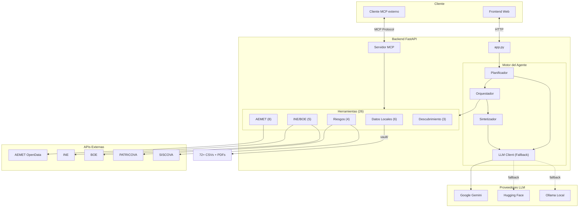

# Municipal Intelligence Agent 🏙️

Agente RAG (Retrieval-Augmented Generation) autónomo y multi-herramienta, diseñado para el análisis de datos municipales abiertos de la Comunitat Valenciana y España. Integra datos demográficos, económicos, catastrales, medioambientales y de riesgos naturales en una única interfaz conversacional.

A diferencia de los sistemas RAG tradicionales basados únicamente en bases de datos vectoriales, este agente selecciona y orquesta dinámicamente múltiples herramientas —APIs en tiempo real, datasets geoespaciales y CSVs demográficos locales— para responder consultas complejas que abarcan varios dominios.

### Fuentes de datos integradas

| Fuente | Tipo | Descripción |
|--------|------|-------------|
| [AEMET OpenData](https://opendata.aemet.es/) | API en tiempo real | Predicciones, avisos meteorológicos, climatología histórica, riesgo de incendios, rayos, montaña y costas |
| [INE](https://www.ine.es/) | API en tiempo real | Búsqueda de operaciones estadísticas, listado de tablas y descarga de datos |
| [BOE](https://www.boe.es/) | API en tiempo real | Resúmenes diarios y documentos del Boletín Oficial del Estado |
| [PATRICOVA](https://visor.gva.es/visor/) | API geoespacial | Riesgo de inundación por coordenadas o nombre de municipio |
| [SISCOVA](https://sismi.icv.gva.es/) | API + scraping | Catálogo sísmico en tiempo real de la Comunitat Valenciana |
| [ICV WMS](https://www.icv.gva.es/) | API geoespacial | Búsqueda de capas cartográficas del Institut Cartogràfic Valencià |
| Vault CSV local | 72+ ficheros CSV | Padrón, censos, catastro, alquileres, paro, afiliados, criminalidad, presupuestos, inundaciones... |
| Vault PDF local | Documentos PDF | Búsqueda semántica sobre documentos indexados con Pinecone |

---

## Características

- **26 herramientas** registradas en un registro dinámico lazy-loading
- **Planificador autónomo**: Descompone consultas complejas en planes de ejecución JSON de 1 a 6 pasos
- **Orquestador multi-paso**: Ejecuta herramientas secuencialmente con resolución automática de dependencias entre pasos (`$PREV.data.0.campo`)
- **Sintetizador**: Combina resultados de múltiples fuentes en respuestas estructuradas en markdown
- **Cadena de fallback LLM**: Cambia automáticamente entre proveedores (Gemini → Hugging Face → Ollama) si hay rate limits o fallos
- **Servidor MCP**: Expone todas las herramientas vía Model Context Protocol para cualquier cliente MCP compatible
- **Interfaz web integrada**: Frontend completo con chat, visualización de herramientas y explorador del vault
- **Caché de catálogo**: Catálogo del vault pre-cargado en memoria para respuestas instantáneas
- **Skills del agente**: Sistema de habilidades inyectadas dinámicamente para guiar el razonamiento del planificador

---

## Herramientas disponibles (26)

### Datos locales (6 herramientas)

| Herramienta | Descripción |
|-------------|-------------|
| `csv_list` | Lista todos los CSVs disponibles con sus cabeceras |
| `csv_reader` | Lectura de CSVs con filtrado multi-columna, ordenación y paginación |
| `csv_aggregate` | Agregaciones (sum, count, avg, min, max) con group_by |
| `file_reader` | Lectura de ficheros (CSV, Excel, JSON, TXT, MD) del vault |
| `vault_catalog` | Catálogo completo de todas las fuentes de datos disponibles |
| `vault_pdf_search` | Búsqueda semántica sobre PDFs indexados en Pinecone |

### AEMET — Meteorología (8 herramientas)

| Herramienta | Descripción |
|-------------|-------------|
| `aemet_forecast` | Predicción diaria/horaria por nombre de municipio |
| `aemet_warnings` | Avisos meteorológicos activos en la Comunitat Valenciana |
| `aemet_observations` | Observaciones actuales de estaciones meteorológicas |
| `aemet_climatology` | Valores normales, datos mensuales/diarios, extremos históricos |
| `aemet_fire_risk` | Índice de riesgo de incendio estimado y previsto |
| `aemet_lightning` | Mapa de descargas eléctricas recientes |
| `aemet_mountain` | Predicción para zonas de montaña (Pirineos, Picos de Europa, Sierra Nevada) |
| `aemet_marine` | Predicción costera y de alta mar |

### Riesgos naturales (4 herramientas)

| Herramienta | Descripción |
|-------------|-------------|
| `patricova_flood_risk` | Riesgo de inundación por coordenadas o nombre de ciudad |
| `siscova_earthquakes` | Eventos sísmicos recientes en tiempo real |
| `siscova_scraper` | Scraping del catálogo sísmico completo |
| `icv_wms_search` | Búsqueda de capas cartográficas WMS del ICV |

### Datos públicos nacionales (5 herramientas)

| Herramienta | Descripción |
|-------------|-------------|
| `ine_search_operations` | Búsqueda de operaciones estadísticas del INE |
| `ine_list_tables` | Listado de tablas disponibles por operación |
| `ine_get_table_data` | Descarga de datos de una tabla del INE |
| `boe_get_summary` | Resumen del BOE de una fecha específica |
| `boe_get_document` | Documento completo del BOE por identificador |

### Descubrimiento y otros (3 herramientas)

| Herramienta | Descripción |
|-------------|-------------|
| `vault_discover` | Inventario estructurado de todos los ficheros del vault |
| `tool_discover` | Lista de herramientas disponibles por categoría |
| `web_search` | Búsqueda web via DuckDuckGo |
| `vision_map_analyzer` | Análisis de imágenes cartográficas con Gemini Vision |
| `general` | Respuestas conversacionales sin herramientas |

---

## Datasets incluidos (72+ ficheros CSV)

El vault local contiene datasets municipales y regionales pre-cargados en `backend/vault/csvs/`:

| Categoría | Ficheros principales |
|-----------|---------------------|
| **Demografía y población** | `poblacion_por_sexo_seccion_y_edad.csv`, `poblacion_segun_sexo.csv`, `nacionalidades.csv`, `padron_continuo_san_vicente_raspeig.csv` |
| **Educación y empleo** | `Sexo_y_nivel_estudios.csv`, `pais_nacimiento_y_nivel_estudios.csv`, `Sexo_y_ocupacion_limpio.csv`, `Sexo_y_situacion_profesional_limpio.csv` |
| **Mercado laboral** | `paro_2008_2025.csv`, `demandantes_2008_2025.csv`, `contratos_2006_2025.csv`, `afiliados_2022_2025.csv` |
| **Vivienda y alquileres** | `resultados_alquileres_final.csv`, `estadisticas_simulacion_alquileres.csv`, `historico_alquileres_octubre_2024.csv`, `ALQ_Secciones_2022_Alicante.csv` |
| **Catastro e inmuebles** | `Datos_inmuebles_documento_procesado_geoinfo.csv`, `numero_inmuebles.csv`, `Parcela_urbana.csv`, `Parcela_rustica.csv` |
| **Renta e ingresos** | `Indicadores_renta_secciones_censales.csv`, `distribucion_por_fuente_de_ingresos.csv`, `pensiones_contributivas_vigor_alicante_historico.csv` |
| **Geografía y censos** | `Secciones_Censales.csv`, `Distritos_Censales.csv`, `comarcas_comunidad_valenciana.csv`, `codigos_postales.csv`, `Info_Municipios.csv` |
| **Riesgos naturales** | `riesgo_inundaciones.csv`, `peligrosidad_inun.csv`, `pelsiscav_clean_seismic_catalog.csv` |
| **Presupuestos** | `Area_gasto_presupuesto.csv`, `Creditos_inicales_presupuestos.csv`, `Prevision_inicales_presupuestos.csv` |
| **Seguridad** | `criminalidad_general.csv`, `criminalidad_convencional.csv`, `criminalidad_ciberdelincuencia.csv` |

> **Nota**: Los ficheros CSV grandes están en `.gitignore` para evitar límites de almacenamiento en GitHub. El agente los indexa y procesa localmente.

---

## Modelos LLM

El agente utiliza un sistema de fallback multi-proveedor con modelos específicos por rol:

| Rol | Proveedor | Modelos |
|-----|-----------|---------|
| **Planificador** | Google Gemini | `gemini-flash-latest`, `gemini-flash-lite-latest`, `gemini-2.5-flash`, `gemini-2.0-flash` |
| **Planificador** | Hugging Face | `Qwen/Qwen2.5-72B-Instruct`, `meta-llama/Meta-Llama-3-8B-Instruct` |
| **Planificador** | Ollama (local) | `qwen2.5:7b`, `llama3` |
| **Sintetizador** | Google Gemini | `gemini-flash-latest`, `gemini-flash-lite-latest`, `gemini-2.5-flash`, `gemini-2.0-flash` |
| **Sintetizador** | Hugging Face | `Qwen/Qwen2.5-7B-Instruct`, `meta-llama/Meta-Llama-3-8B-Instruct` |
| **Sintetizador** | Ollama (local) | `qwen2.5:7b`, `llama3` |

Prioridad de fallback: **Google Gemini → Hugging Face Inference → Ollama local**

---

## Arquitectura

```
municipal-intelligence-agent/
├── backend/
│   ├── app.py                    # Servidor FastAPI principal
│   ├── core/                     # Motor del agente
│   │   ├── planner.py            # Planificador (consulta → plan JSON)
│   │   ├── orchestrator.py       # Orquestador (ejecuta herramientas)
│   │   ├── synthesis.py          # Sintetizador (resultados → respuesta)
│   │   ├── llm.py                # Cliente LLM multi-proveedor con fallback
│   │   ├── registry.py           # Registro dinámico de herramientas (lazy-loading)
│   │   ├── prompts.py            # System prompts del planificador y sintetizador
│   │   ├── memory.py             # Memoria conversacional por sesión
│   │   ├── cache.py              # Caché del catálogo del vault
│   │   ├── tracer.py             # Trazabilidad de ejecución
│   │   └── providers/            # Proveedores LLM (Gemini, HF, Ollama)
│   ├── tools/
│   │   ├── api/                  # Herramientas de APIs externas (AEMET, INE, BOE, SISCOVA...)
│   │   ├── local/                # Herramientas de datos locales (CSV, PDF, vault)
│   │   └── discovery/            # Herramientas de descubrimiento
│   ├── skills/                   # Habilidades inyectadas al planificador
│   ├── mcp_core/                 # Servidor y cliente MCP
│   └── vault/                    # Almacén de datos (CSVs, PDFs, catálogos)
├── frontend/                     # Interfaz web (HTML + JS + CSS)
│   ├── index.html                # Página principal
│   ├── index.css / styles.css    # Estilos
│   ├── main.js                   # Lógica principal del dashboard
│   ├── chat.js                   # Módulo de chat
│   ├── vault.js                  # Explorador del vault
│   └── markdown.js               # Renderizado de markdown
├── pyproject.toml                # Dependencias y configuración del proyecto
├── .env.example                  # Template de variables de entorno
└── README.md
```



---

## Ejemplos de uso

### Consultar datos de empleo
```
Usuario: ¿Cuál es la evolución del paro en Alicante desde 2020?
Agente:  [Plan: csv_reader(filename="paro_2008_2025.csv", filter_column="...", filter_value="Alicante", max_rows=50)]
         → Sintetiza tendencias con datos reales del CSV
```

### Predicción meteorológica
```
Usuario: ¿Qué tiempo hará mañana en Valencia?
Agente:  [Plan: aemet_forecast(municipio="valencia", mode="daily")]
         → Devuelve predicción detallada de la AEMET
```

### Riesgo de inundación
```
Usuario: ¿Cuál es el riesgo de inundación en Alzira?
Agente:  [Plan: patricova_flood_risk(location_name="Alzira")]
         → Consulta PATRICOVA y devuelve nivel de peligrosidad
```

### Consulta cruzada multi-herramienta
```
Usuario: Dame los datos de educación y paro de San Vicente del Raspeig
Agente:  [Plan: 
           Paso 1: csv_reader(filename="Sexo_y_nivel_estudios.csv", filter_value="San Vicente", max_rows=50)
           Paso 2: csv_reader(filename="paro_2008_2025.csv", filter_value="San Vicente", max_rows=50)]
         → Sintetiza ambos datasets en una respuesta coherente
```

---

## Requisitos

- Python 3.10 o superior
- pip

## Instalación

```bash
# Clonar el repositorio
git clone https://github.com/chikabdou06-crypto/municipal-intelligence-agent.git
cd municipal-intelligence-agent

# Instalar dependencias
pip install -e .
```

Crea un archivo `.env` basándote en `.env.example`:

```bash
cp .env.example .env
```

Variables de entorno necesarias:

| Variable | Descripción |
|----------|-------------|
| `GOOGLE_API_KEY` | API key de Google Gemini (obligatoria para el modo cloud) |
| `AEMET_API_KEY` | API key de AEMET OpenData ([obtener gratis](https://opendata.aemet.es/centrodedescargas/altaUsuario)) |
| `PINECONE_API_KEY` | API key de Pinecone (opcional, para búsqueda semántica en PDFs) |
| `HF_TOKEN` | Token de Hugging Face (opcional, para fallback a modelos HF) |

## Ejecutar el servidor

```bash
# Modo desarrollo (con recarga automática)
python -m uvicorn backend.app:app --host 127.0.0.1 --port 8000 --reload
```

Accede a `http://127.0.0.1:8000` en tu navegador.

## Ejecutar como servidor MCP

```bash
# Para conectar desde cualquier cliente MCP compatible
python -m backend.mcp_core.mcp_server
```

---

## Limitaciones

- **Rate limits de AEMET**: La API de AEMET tiene cuotas estrictas por minuto. Si se exceden, el agente no podrá obtener datos meteorológicos hasta que se restablezca la cuota.
- **Ventana de tokens**: El agente limita automáticamente las consultas CSV a `max_rows=50` para evitar desbordar la ventana de contexto del LLM durante la síntesis.
- **Ámbito geográfico**: Los datasets y APIs están orientados a España (específicamente la Comunitat Valenciana). Consultas fuera de esta región dependerán del conocimiento base del LLM.
- **PDFs y Pinecone**: La búsqueda semántica en PDFs requiere una instancia de Pinecone configurada y documentos previamente indexados.

---

## Licencia

MIT License

## Enlaces

- [AEMET OpenData](https://opendata.aemet.es/) — API meteorológica
- [INE](https://www.ine.es/) — Instituto Nacional de Estadística
- [BOE](https://www.boe.es/) — Boletín Oficial del Estado
- [Model Context Protocol](https://modelcontextprotocol.io/) — Especificación MCP
- [FastAPI](https://fastapi.tiangolo.com/) — Framework web
