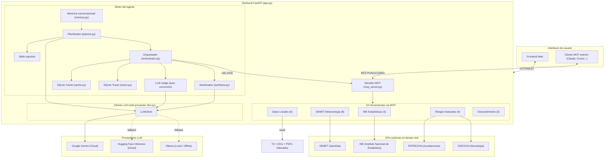

# Municipal Intelligence Agent 🏙️

**Agente RAG autónomo y multi-herramienta para el análisis de datos municipales abiertos de la Comunitat Valenciana y España.**

Un sistema de inteligencia artificial que integra datos demográficos, económicos, catastrales, medioambientales y de riesgos naturales en una única interfaz conversacional. A diferencia de los sistemas RAG tradicionales basados únicamente en bases de datos vectoriales, este agente selecciona y orquesta dinámicamente múltiples herramientas — APIs en tiempo real, datasets geoespaciales y CSVs demográficos locales — para responder consultas complejas que abarcan varios dominios.

> **Trabajo Fin de Máster** — Desarrollado como TFM en el ámbito de la inteligencia artificial aplicada a datos públicos municipales.

---

## Tabla de contenidos

- [Arquitectura del sistema](#arquitectura-del-sistema)
  - [Vista general](#vista-general)
  - [1. El Planificador](#1-el-planificador-planner)
  - [2. El Orquestador](#2-el-orquestador-orchestrator)
  - [3. LLM as a Judge](#3-llm-as-a-judge-auto-corrección)
  - [4. Caché SQLite y trazabilidad](#4-caché-sqlite-y-trazabilidad)
  - [5. El Sintetizador](#5-el-sintetizador-synthesizer)
  - [6. Cadena de fallback LLM](#6-cadena-de-fallback-multi-proveedor)
  - [7. Memoria conversacional](#7-memoria-conversacional)
  - [8. Servidor MCP](#8-servidor-mcp)
- [Herramientas disponibles](#herramientas-disponibles-24)
- [Datasets incluidos](#datasets-incluidos-72-ficheros-csv)
- [Interfaz de usuario](#interfaz-de-usuario)
- [Modelos LLM](#modelos-llm)
- [Instalación y uso](#instalación-y-uso)
- [Ejemplos de uso](#ejemplos-de-uso)
- [Limitaciones conocidas](#limitaciones-conocidas)

---

## Arquitectura del sistema

### Vista general

El agente está diseñado en torno a una arquitectura modular de tipo **Plan-and-Solve** con auto-corrección. En lugar de depender de un único prompt monolítico que intenta resolver todo a la vez, el flujo de trabajo se descompone en componentes especializados que colaboran en cadena:

```
  ┌────────────────────┐
  │   User Request     │
  └────────┬───────────┘
           ▼
  ┌────────────────────┐     ┌─────────────────────┐
  │   1. PLANNER       │────▶│  Skills Injection    │
  │   (planner.py)     │     │  + Vault Catalog     │
  └────────┬───────────┘     └─────────────────────┘
           │ JSON Execution Plan (1-6 steps)
           ▼
  ┌────────────────────┐     ┌─────────────────────┐
  │  2. ORCHESTRATOR   │◀───▶│  SQLite Cache        │
  │  (orchestrator.py) │     │  (cache.py)          │
  └────────┬───────────┘     └─────────────────────┘
           │  ┌──────────────────────────────┐
           │  │  For each step:              │
           │  │  • Resolve $PREV deps        │
           │  │  • Check cache → hit? skip   │
           │  │  • Execute via MCP Server    │
           │  │  • On error → LLM Judge fix  │
           │  │  • Save to cache + tracer    │
           │  └──────────────────────────────┘
           │ Collected tool results
           ▼
  ┌────────────────────┐     ┌─────────────────────┐
  │  3. SYNTHESIZER    │────▶│  Tracer (SQLite)     │
  │  (synthesis.py)    │     │  (tracer.py)         │
  └────────┬───────────┘     └─────────────────────┘
           │
           ▼
  ┌────────────────────┐
  │  Markdown Response │
  └────────────────────┘
```



---

### 1. El Planificador (Planner)

**Fichero:** `backend/core/planner.py`

El ciclo de vida de cada consulta comienza en el Planificador. Es un LLM configurado con temperatura baja (`0.1`) y optimizado exclusivamente para razonamiento estructural: analiza la pregunta del usuario y genera un plan de ejecución JSON que describe exactamente qué herramientas llamar, en qué orden, y con qué argumentos.

**Funcionamiento interno:**

1. **Descubrimiento de Skills:** El Planificador escanea la carpeta `backend/skills/` y lee únicamente el frontmatter (metadatos) de cada fichero `.md`. Esto es extremadamente ligero y no consume tokens.

2. **Selección por palabras clave:** Compara las palabras de la consulta del usuario contra las descripciones de los skills. Solo los skills relevantes se inyectan como contexto completo en el prompt — evitando saturar la ventana de contexto del LLM con información irrelevante (patrón *Progressive Skill Disclosure*).

3. **Generación del catálogo de herramientas:** El Planificador solicita al servidor MCP la lista de herramientas disponibles (nombre, descripción, esquema de parámetros) y las presenta como un menú de opciones. No importa módulos Python directamente gracias al registro lazy-loading (`_lazy_registry_static.py`).

4. **Inyección del catálogo del vault:** El catálogo completo de ficheros CSV (nombres + columnas) se inyecta para que el LLM pueda seleccionar el fichero correcto sin adivinaciones.

5. **Inyección de memoria conversacional:** Si la sesión tiene historial previo, se inyecta un resumen de los últimos 5 intercambios para mantener coherencia contextual.

6. **Salida:** Un array JSON de 1 a 6 pasos, cada uno con `tool` y `arguments`. El Planificador nunca ejecuta código.

```json
{
  "steps": [
    { "tool": "csv_reader", "arguments": { "filename": "paro_2008_2025.csv", "filter_value": "Alicante" } },
    { "tool": "aemet_forecast", "arguments": { "municipio": "alicante", "mode": "daily" } }
  ]
}
```

---

### 2. El Orquestador (Orchestrator)

**Fichero:** `backend/core/orchestrator.py`

El Orquestador es el motor de ejecución. Toma el plan JSON del Planificador y lo ejecuta paso a paso, gestionando dependencias, caché y errores.

**Capacidades clave:**

- **Resolución de dependencias entre pasos:** Si el Paso 2 necesita un dato producido por el Paso 1, el Planificador lo marca con la sintaxis de placeholders `$PREV.data.0.campo` o `$STEP_0.data.postal`. El Orquestador resuelve estas referencias dinámicamente antes de ejecutar cada paso, navegando estructuras JSON anidadas con el resolver `_deep_get()`.

- **Búsqueda inteligente hacia atrás:** Si `$PREV` apunta a un paso que falló, el Orquestador no se rinde — busca hacia atrás en los pasos anteriores exitosos para encontrar el dato solicitado.

- **Ejecución via MCP:** Todas las herramientas se invocan a través del servidor MCP interno (`mcp_client.py`), lo que garantiza un contrato uniforme de entrada/salida y aísla completamente el motor del agente de las implementaciones individuales de cada herramienta.

---

### 3. LLM as a Judge (Auto-corrección)

**Fichero:** `backend/core/orchestrator.py` → `_invoke_llm_judge()`

Este es el mecanismo de máxima resiliencia del sistema. Cuando el Orquestador intenta ejecutar una herramienta y esta falla por un error de esquema, validación o formato de argumentos:

1. El Orquestador **intercepta el error** y extrae el stack trace.
2. Invoca a una instancia secundaria del LLM (el *Juez*) con temperatura `0.0` para máxima determinismo.
3. Le proporciona al Juez: el nombre de la herramienta, los argumentos fallidos y el mensaje de error exacto.
4. El Juez **re-escribe los argumentos JSON** corrigiendo el error (por ejemplo: un tipo de dato incorrecto, un parámetro mal nombrado, un valor fuera de rango).
5. El Orquestador **reintenta la ejecución** con los argumentos corregidos.

Este bucle de reflexión se ejecuta de forma completamente autónoma y transparente para el usuario. Si la corrección también falla, el sistema registra el error y continúa con los pasos restantes del plan.

---

### 4. Caché SQLite y trazabilidad

**Ficheros:** `backend/core/cache.py` y `backend/core/tracer.py`

El sistema implementa una base de datos local SQLite (`backend/vault/cache/execution_cache.sqlite`) que cumple un doble propósito:

#### Caché de ejecución (`cache.py`)
- Antes de cada llamada a una herramienta, el Orquestador genera un hash SHA-256 del nombre de la herramienta + argumentos.
- Si existe un resultado idéntico en la caché y tiene menos de 6 horas (TTL configurable), se devuelve instantáneamente sin consumir red, API ni tokens LLM.
- Las herramientas que producen datos estáticos o semi-estáticos (CSVs locales, operaciones del INE) se benefician enormemente de este mecanismo.

#### Trazabilidad (`tracer.py`)
- Cada ciclo completo del agente (Planificación → Ejecución → Síntesis) se registra como una fila en la tabla `agent_traces` de la misma base de datos SQLite.
- Se almacena: el prompt del usuario, el plan JSON generado, los resultados de ejecución de cada herramienta, la respuesta sintetizada, las herramientas utilizadas, el número de reintentos y el tiempo total en milisegundos.
- Estos datos permiten una auditoría completa del razonamiento interno del agente.

---

### 5. El Sintetizador (Synthesizer)

**Fichero:** `backend/core/synthesis.py`

Una vez el Orquestador ha recopilado todos los datos en crudo de las herramientas, el Sintetizador los transforma en una respuesta narrativa coherente.

**Funcionamiento:**

- **Fast-path conversacional:** Si el plan solo contiene la herramienta `general` (chitchat), el Sintetizador genera una respuesta breve y conversacional sin procesar datos.
- **Agregación de contexto:** Para consultas con datos, toma la consulta original junto con un volcado completo de los resultados crudos (JSON, tablas, metadatos) devueltos por el Orquestador.
- **Formateo estructurado:** Genera respuestas en Markdown (GitHub Flavored) con tablas, listas, y — cuando la herramienta devuelve URLs de mapas o iframes — los integra dinámicamente en la respuesta.
- **Limpieza de artefactos:** Elimina automáticamente bloques `<thinking>` que algunos modelos (como Gemini) producen internamente, para que el usuario reciba únicamente la respuesta final.

---

### 6. Cadena de fallback multi-proveedor

**Ficheros:** `backend/core/llm.py` y `backend/core/providers/`

El cliente LLM implementa un patrón de resiliencia en cascada con tres proveedores independientes:

```
Google Gemini (Cloud) → Hugging Face Inference (Cloud) → Ollama (Local/Offline)
```

**Características:**

- **Selección por rol:** Cada componente del agente (Planificador, Sintetizador, Juez) tiene su propia lista priorizada de modelos. Por ejemplo, el Planificador puede usar `gemini-flash-latest` mientras que el Sintetizador usa `gemini-2.5-flash`.
- **Fallback automático:** Si el proveedor principal falla (por rate limit `429`, timeout, o error de red), el sistema rota automáticamente al siguiente sin intervención del usuario.
- **Modo forzado:** El usuario puede forzar un proveedor específico desde la interfaz web (`auto`, `gemini`, `ollama`) para escenarios offline o de depuración.
- **Estimación de tokens:** El sistema lleva un contador aproximado de tokens consumidos por sesión (`SESSION_TOKENS_USED`), visible en el dashboard.

---

### 7. Memoria conversacional

**Fichero:** `backend/core/memory.py`

El agente mantiene una memoria conversacional por sesión basada en una ventana deslizante de los últimos 5 intercambios (10 mensajes: 5 del usuario + 5 del asistente). 

- Las respuestas largas del asistente se truncan a 400 caracteres en el contexto inyectado para mantener un consumo de tokens eficiente.
- Cada sesión se identifica por un UUID de 12 caracteres generado automáticamente.
- La memoria se inyecta en el prompt del Planificador como un bloque estructurado, permitiendo consultas de seguimiento como *"¿y en Valencia?"* después de haber preguntado sobre el paro en Alicante.

---

### 8. Servidor MCP

**Ficheros:** `backend/mcp_core/mcp_server.py` y `backend/mcp_core/mcp_client.py`

El sistema implementa el [Model Context Protocol (MCP)](https://modelcontextprotocol.io/) como capa de abstracción para la ejecución de herramientas. Esto proporciona dos interfaces de acceso simultáneas:

| Interfaz | Protocolo | Uso |
|----------|-----------|-----|
| **Frontend Web** | HTTP/REST → MCP interno | Usuarios humanos interactúan a través del navegador |
| **Cliente MCP externo** | MCP (stdio) | Clientes compatibles (Claude Desktop, Cursor IDE, etc.) acceden directamente a las 24 herramientas |

**Arquitectura interna:**
- El `mcp_server.py` expone todas las herramientas registradas en el `_lazy_registry_static.py` como herramientas MCP estándar, con esquemas JSON generados automáticamente desde las type hints de Python (`BaseTool.get_schema()`).
- El `mcp_client.py` gestiona un proceso MCP en background mediante un event loop asyncio dedicado en un thread separado, con timeouts configurables (30s para startup, 120s para ejecución de herramientas).
- Todas las herramientas heredan de `BaseTool` y exponen un método `safe_execute()` que garantiza un esquema de respuesta uniforme (`status`, `source`, `data`, `metadata`, `error_message`), evitando fallos en cascada durante la resolución de dependencias.

---

## Herramientas disponibles (24)

### Datos locales (6 herramientas)

| Herramienta | Descripción |
|-------------|-------------|
| `csv_list` | Lista todos los CSVs disponibles con sus cabeceras |
| `csv_reader` | Lectura de CSVs con filtrado multi-columna, ordenación y paginación |
| `csv_aggregate` | Agregaciones (sum, count, avg, min, max) con group_by |
| `file_reader` | Lectura de ficheros (CSV, Excel, JSON, TXT, MD) del vault |
| `vault_catalog` | Catálogo completo de todas las fuentes de datos disponibles |
| `vault_pdf_search` | Búsqueda semántica sobre PDFs indexados en Pinecone |

### AEMET — Meteorología (8 herramientas)

| Herramienta | Descripción |
|-------------|-------------|
| `aemet_forecast` | Predicción diaria/horaria por nombre de municipio |
| `aemet_warnings` | Avisos meteorológicos activos en la Comunitat Valenciana |
| `aemet_observations` | Observaciones actuales de estaciones meteorológicas |
| `aemet_climatology` | Valores normales, datos mensuales/diarios, extremos históricos |
| `aemet_fire_risk` | Mapas de riesgo de incendio e índice de radiación UV |
| `aemet_lightning` | Mapa de descargas eléctricas recientes |
| `aemet_mountain` | Predicción para zonas de montaña (Pirineos, Picos de Europa, Sierra Nevada) |
| `aemet_marine` | Predicción costera y de alta mar |

### Riesgos naturales (4 herramientas)

| Herramienta | Descripción |
|-------------|-------------|
| `patricova_flood_risk` | Riesgo de inundación por coordenadas o nombre de municipio (API geoespacial) |
| `siscova_earthquakes` | Eventos sísmicos recientes en tiempo real |
| `siscova_scraper` | Scraping del catálogo sísmico completo de la Comunitat Valenciana |
| `icv_wms_search` | Búsqueda de capas cartográficas WMS del Institut Cartogràfic Valencià |

### Datos públicos nacionales — INE (3 herramientas)

| Herramienta | Descripción |
|-------------|-------------|
| `ine_search_operations` | Búsqueda de operaciones estadísticas del Instituto Nacional de Estadística |
| `ine_list_tables` | Listado de tablas disponibles por operación |
| `ine_get_table_data` | Descarga de datos de una tabla del INE |

### Descubrimiento y utilidades (3 herramientas)

| Herramienta | Descripción |
|-------------|-------------|
| `vault_discover` | Inventario estructurado de todos los ficheros del vault |
| `tool_discover` | Lista de herramientas disponibles por categoría |
| `general` | Respuestas conversacionales sin herramientas |

### Fuentes de datos integradas

| Fuente | Tipo | Descripción |
|--------|------|-------------|
| [AEMET OpenData](https://opendata.aemet.es/) | API en tiempo real | Predicciones, avisos, climatología, riesgo de incendios, rayos, montaña y costas |
| [INE](https://www.ine.es/) | API en tiempo real | Operaciones estadísticas, tablas y datos del Instituto Nacional de Estadística |
| [PATRICOVA](https://visor.gva.es/visor/) | API geoespacial | Riesgo de inundación por coordenadas o nombre de municipio |
| [SISCOVA](https://sismi.icv.gva.es/) | API + scraping | Catálogo sísmico en tiempo real de la Comunitat Valenciana |
| [ICV WMS](https://www.icv.gva.es/) | API geoespacial | Capas cartográficas del Institut Cartogràfic Valencià |
| Vault CSV local | 72+ ficheros | Padrón, censos, catastro, alquileres, paro, afiliados, criminalidad, presupuestos |
| Vault PDF local | Documentos | Búsqueda semántica sobre PDFs indexados con Pinecone |

---

## Datasets incluidos (72+ ficheros CSV)

El vault local contiene datasets municipales y regionales pre-cargados en `backend/vault/csvs/`:

| Categoría | Ficheros principales |
|-----------|---------------------|
| **Demografía y población** | `poblacion_por_sexo_seccion_y_edad.csv`, `poblacion_segun_sexo.csv`, `nacionalidades.csv`, `padron_continuo_san_vicente_raspeig.csv` |
| **Educación y empleo** | `Sexo_y_nivel_estudios.csv`, `pais_nacimiento_y_nivel_estudios.csv`, `Sexo_y_ocupacion_limpio.csv`, `Sexo_y_situacion_profesional_limpio.csv` |
| **Mercado laboral** | `paro_2008_2025.csv`, `demandantes_2008_2025.csv`, `contratos_2006_2025.csv`, `afiliados_2022_2025.csv` |
| **Vivienda y alquileres** | `resultados_alquileres_final.csv`, `estadisticas_simulacion_alquileres.csv`, `historico_alquileres_octubre_2024.csv`, `ALQ_Secciones_2022_Alicante.csv` |
| **Catastro e inmuebles** | `Datos_inmuebles_documento_procesado_geoinfo.csv`, `numero_inmuebles.csv`, `Parcela_urbana.csv`, `Parcela_rustica.csv` |
| **Renta e ingresos** | `Indicadores_renta_secciones_censales.csv`, `distribucion_por_fuente_de_ingresos.csv`, `pensiones_contributivas_vigor_alicante_historico.csv` |
| **Geografía y censos** | `Secciones_Censales.csv`, `Distritos_Censales.csv`, `comarcas_comunidad_valenciana.csv`, `codigos_postales.csv`, `Info_Municipios.csv` |
| **Riesgos naturales** | `riesgo_inundaciones.csv`, `peligrosidad_inun.csv`, `pelsiscav_clean_seismic_catalog.csv` |
| **Presupuestos** | `Area_gasto_presupuesto.csv`, `Creditos_inicales_presupuestos.csv`, `Prevision_inicales_presupuestos.csv` |
| **Seguridad** | `criminalidad_general.csv`, `criminalidad_convencional.csv`, `criminalidad_ciberdelincuencia.csv` |

> **Nota:** Los ficheros CSV de gran tamaño están excluidos de Git (`.gitignore`). El agente los indexa y procesa localmente mediante el pipeline de ingestión.

---

## Interfaz de usuario

El sistema incluye un frontend web integrado accesible en `http://localhost:8000/`.

Este dashboard proporciona un chat interactivo, un explorador completo del vault (archivos indexados), y un visor integrado para las tablas de datos CSV. Es una interfaz estática (HTML + CSS + JS vanilla) servida directamente por FastAPI, sin depender de frameworks externos complejos.

---

## Modelos LLM

El agente utiliza un sistema de fallback multi-proveedor con modelos específicos por rol:

| Rol | Proveedor | Modelos |
|-----|-----------|---------|
| **Planificador** | Google Gemini | `gemini-flash-latest`, `gemini-flash-lite-latest`, `gemini-2.5-flash`, `gemini-2.0-flash` |
| **Planificador** | Hugging Face | `Qwen/Qwen2.5-72B-Instruct`, `meta-llama/Meta-Llama-3-8B-Instruct` |
| **Planificador** | Ollama (local) | `qwen2.5:7b`, `llama3` |
| **Sintetizador** | Google Gemini | `gemini-flash-latest`, `gemini-flash-lite-latest`, `gemini-2.5-flash`, `gemini-2.0-flash` |
| **Sintetizador** | Hugging Face | `Qwen/Qwen2.5-7B-Instruct`, `meta-llama/Meta-Llama-3-8B-Instruct` |
| **Sintetizador** | Ollama (local) | `qwen2.5:7b`, `llama3` |

**Prioridad de fallback:** Google Gemini → Hugging Face Inference → Ollama local

---

## Estructura del proyecto

```
municipal-intelligence-agent/
├── backend/
│   ├── app.py                    # Servidor FastAPI — punto de entrada principal
│   ├── core/                     # Motor del agente
│   │   ├── planner.py            # Planificador (consulta → plan JSON)
│   │   ├── orchestrator.py       # Orquestador (ejecuta herramientas con auto-corrección)
│   │   ├── synthesis.py          # Sintetizador (resultados → respuesta markdown)
│   │   ├── llm.py                # Cliente LLM multi-proveedor con fallback
│   │   ├── registry.py           # Registro dinámico de herramientas (lazy-loading)
│   │   ├── _lazy_registry_static.py  # Mapa estático de herramientas → módulos
│   │   ├── base_tool.py          # Clase base abstracta para todas las herramientas
│   │   ├── prompts.py            # System prompts del planificador y sintetizador
│   │   ├── memory.py             # Memoria conversacional por sesión (ventana deslizante)
│   │   ├── cache.py              # Caché de ejecución SQLite con TTL
│   │   ├── tracer.py             # Trazabilidad de cada ciclo del agente
│   │   ├── catalog_loader.py     # Carga del catálogo del vault (CSVs + PDFs)
│   │   ├── vault_paths.py        # Rutas canónicas del vault
│   │   ├── network_patch.py      # Parches DNS para redes restrictivas
│   │   └── providers/            # Proveedores LLM
│   │       ├── base.py           # Clase abstracta BaseLLMProvider
│   │       ├── gemini.py         # Google Gemini (google-genai SDK)
│   │       ├── hf.py             # Hugging Face Inference API
│   │       └── ollama.py         # Ollama (modelos locales)
│   ├── tools/
│   │   ├── api/                  # Herramientas de APIs externas (AEMET, INE, SISCOVA...)
│   │   ├── local/                # Herramientas de datos locales (CSV, PDF, vault)
│   │   └── discovery/            # Herramientas de descubrimiento
│   ├── skills/                   # Habilidades inyectadas al planificador
│   │   ├── api_guidance.md       # Directrices para llamadas a APIs externas
│   │   ├── csv_cross_reference.md # Guía de referencias cruzadas entre CSVs
│   │   ├── data_routing.md       # Reglas de enrutamiento de datos
│   │   └── emergency_protocols.md # Protocolos de emergencia (incendios, inundaciones, sismos)
│   ├── mcp_core/                 # Implementación del Model Context Protocol
│   │   ├── mcp_server.py         # Servidor MCP (expone herramientas via stdio)
│   │   └── mcp_client.py         # Cliente MCP (gestión de sesión con threading)
│   ├── ingest/                   # Pipeline de ingestión de datos
│   │   ├── index_csvs.py         # Indexación automática de CSVs
│   │   └── index_pdfs.py         # Indexación de PDFs en Pinecone
│   └── vault/                    # Almacén de datos
│       ├── csvs/                 # 72+ ficheros CSV municipales
│       ├── pdfs/                 # Documentos PDF para búsqueda semántica
│       ├── catalogs/             # Catálogos JSON generados
│       └── cache/                # Base de datos SQLite (caché + trazas)
├── frontend/                     # Interfaz web interactiva
├── pyproject.toml                # Dependencias y configuración del proyecto
├── .env.example                  # Template de variables de entorno
└── README.md
```

---

## Instalación y uso

### Requisitos previos

- Python 3.10 o superior
- pip

### Instalación

```bash
# Clonar el repositorio
git clone https://github.com/chikabdou06-crypto/municipal-intelligence-agent.git
cd municipal-intelligence-agent

# Instalar dependencias
pip install -e .
```

### Configuración

Crea un archivo `.env` basándote en `.env.example`:

```bash
cp .env.example .env
```

| Variable | Requerida | Descripción |
|----------|-----------|-------------|
| `GOOGLE_API_KEY` | **Sí** | API key de Google Gemini ([Google AI Studio](https://aistudio.google.com/)) |
| `AEMET_API_KEY` | **Sí** | API key de AEMET OpenData ([obtener gratis](https://opendata.aemet.es/centrodedescargas/altaUsuario)) |
| `PINECONE_API_KEY` | Opcional | Para búsqueda semántica en PDFs |
| `HF_TOKEN` | Opcional | Token de Hugging Face para fallback a modelos HF |

### Ejecutar el servidor web

```bash
# Modo desarrollo (con recarga automática)
python -m uvicorn backend.app:app --host 127.0.0.1 --port 8000 --reload
```

Accede a `http://127.0.0.1:8000` en tu navegador para abrir el dashboard.

### Ejecutar como servidor MCP

```bash
# Para conectar desde Claude Desktop, Cursor, o cualquier cliente MCP compatible
python -m backend.mcp_core.mcp_server
```

### Pipeline de ingestión

```bash
# Indexar todos los CSVs del vault (genera catálogos JSON)
python backend/ingest.py csvs

# Indexar PDFs en Pinecone (requiere PINECONE_API_KEY)
python backend/ingest.py pdfs
```

---

## Ejemplos de uso

### Consultar datos de empleo
```
Usuario: ¿Cuál es la evolución del paro en Alicante desde 2020?

Plan:   [csv_reader(filename="paro_2008_2025.csv", filter_value="Alicante")]
        → Sintetiza tendencias con datos reales del CSV
```

### Predicción meteorológica
```
Usuario: ¿Qué tiempo hará mañana en Valencia?

Plan:   [aemet_forecast(municipio="valencia", mode="daily")]
        → Devuelve predicción detallada de la AEMET
```

### Riesgo de inundación
```
Usuario: ¿Cuál es el riesgo de inundación en Alzira?

Plan:   [patricova_flood_risk(location_name="Alzira")]
        → Consulta PATRICOVA y devuelve nivel de peligrosidad
```

### Consulta cruzada multi-herramienta
```
Usuario: Dame los datos de educación y paro de San Vicente del Raspeig

Plan:   [Paso 1: csv_reader(filename="Sexo_y_nivel_estudios.csv", filter_value="San Vicente")
         Paso 2: csv_reader(filename="paro_2008_2025.csv", filter_value="San Vicente")]
        → Sintetiza ambos datasets en una respuesta coherente
```

### Emergencia con combinación de fuentes
```
Usuario: ¿Ha habido terremotos recientes cerca de Alicante y cuál es el protocolo de emergencia?

Plan:   [Paso 1: siscova_earthquakes()
         Paso 2: csv_reader(filename="pelsiscav_clean_seismic_catalog.csv", filter_value="ALACANT")
         Paso 3: vault_pdf_search(query="protocolo emergencia sísmica")]
        → Combina datos en vivo, históricos y documentación interna
```

---

## Limitaciones conocidas

| Limitación | Descripción |
|------------|-------------|
| **Ámbito geográfico** | Los datasets y APIs están orientados a España, específicamente la Comunitat Valenciana. Consultas fuera de esta región dependen del conocimiento base del LLM. |
| **Rate limits de AEMET** | La API de AEMET tiene cuotas estrictas por minuto. Si se exceden, el agente no podrá obtener datos meteorológicos hasta que se restablezca la cuota. |
| **Ventana de contexto** | Las consultas CSV se limitan a `max_rows=50` por defecto para evitar desbordar la ventana de contexto del LLM durante la síntesis. |
| **Datos estáticos del vault** | Los CSVs del vault representan snapshots históricos. No se actualizan automáticamente — requieren re-ingestión manual. |
| **PDFs y Pinecone** | La búsqueda semántica en PDFs requiere una instancia de Pinecone configurada y documentos previamente indexados con el pipeline de ingestión. |
| **Cobertura del INE** | La integración con el INE permite buscar operaciones y descargar tablas, pero el formateo de series temporales complejas puede requerir consultas iterativas. |

---

## Licencia

Este proyecto está licenciado bajo la **MIT License**. Consulta el fichero `LICENSE` para más detalles.

---

## Autor

**Chikh Abderrahmene**

- Trabajo Fin de Máster (TFM) — [Universidad de Alicante](https://www.ua.es/)
- GitHub: [@chikabdou06-crypto](https://github.com/chikabdou06-crypto)

---

## Enlaces

- [AEMET OpenData](https://opendata.aemet.es/) — API meteorológica de España
- [INE](https://www.ine.es/) — Instituto Nacional de Estadística
- [PATRICOVA](https://visor.gva.es/visor/) — Plan de Acción Territorial de carácter sectorial sobre prevención del Riesgo de Inundación
- [SISCOVA](https://sismi.icv.gva.es/) — Sistema de Información Sísmica de la Comunitat Valenciana
- [Model Context Protocol](https://modelcontextprotocol.io/) — Especificación MCP
- [FastAPI](https://fastapi.tiangolo.com/) — Framework web
- [Pinecone](https://www.pinecone.io/) — Base de datos vectorial
