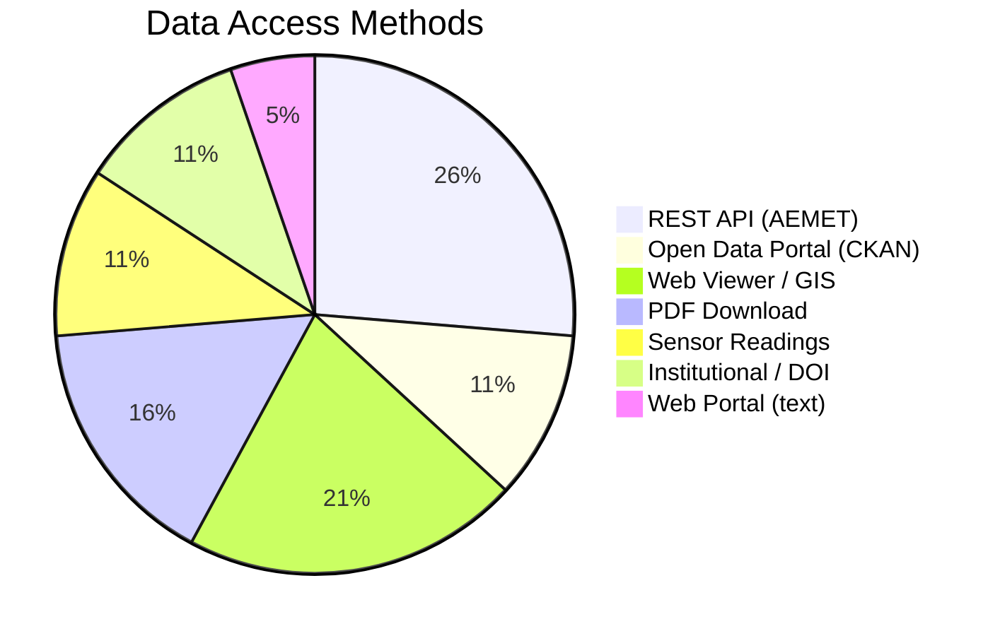
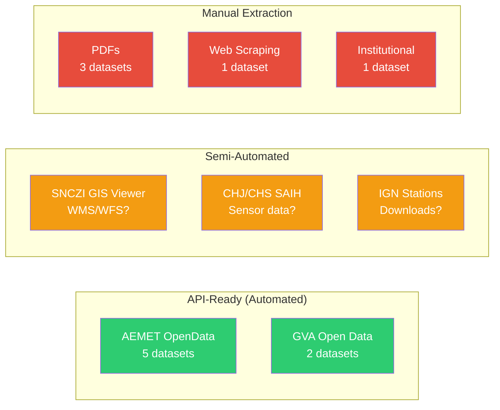

# 📊 Data Sources Inventory — AI Risk CENID Report v1.0

> Extracted from [report-ai-risk-cenid-v1.0.txt](file:///c:/Users/PCSTAR/Desktop/TFM/RAG_BASIC_TEST_LANGCHAIN/report-ai-risk-cenid-v1.0.txt)

---

## Quick Summary

| Category | # of Datasets | Main Providers |
|---|---|---|
| 🔴 Seismic | 6 | ICV, IGN, GVA, Univ. Alicante |
| 🔵 Flood / Hydrological | 5 | SNCZI, ICV, CHJ, CHS, IGN |
| 🌤️ Meteorological | 4 | AEMET |
| 🌡️ Climate Projections | 2 | AEMET, AdapteCCa |
| 🚨 Emergency / Risk | 2 | GVA (112CV) |
| **Total** | **19** | |

---

## Master Table — All Datasets

| ID | Provider | Domain | Data Type | Access Method | Link |
|---|---|---|---|---|---|
| `spaicv31_siscova_sismos` | Institut Cartogràfic Valencià | Seismic | Structured (catalog) | Open Data Portal | [🔗](https://dadesobertes.gva.es/es/dataset/red-sismica-de-la-comunitat-valenciana-siscova-catalogo-de-eventos-sismicos-2022-actualidad) |

| `pelsiscav_anexo_b` | Generalitat Valenciana | Seismic | PDF (historical catalog) | PDF Download | [🔗](https://www.112cv.gva.es/documents/163565706/174341437/Pel_Sis_CV_Anex.pdf) |

| `pelsiscav_anexo_e` | Generalitat Valenciana | Seismic | PDF (intensity tables) | PDF Download | [🔗](https://www.112cv.gva.es/documents/163565706/174341437/Pel_Sis_CV_Anex.pdf) |

| `siscova-stations` | SISCOVA | Seismic | Sensor readings | Web Viewer | [🔗](https://www.siscova.es/es/estaciones-sismicas) |

| `ign-stations` | IGN | Seismic | Sensor readings | Web Viewer | [🔗](https://www.ign.es/web/sis-estaciones-sismicas) |

| `afon-alicante` | Univ. Alicante | Seismic | Accelerograms / catalog | Institutional | No public URL |

| `spa_icv_orde_patricova_peligrosidad_inun` | Institut Cartogràfic Valencià | Flood | Cartography (GIS) | Open Data Portal | [🔗](https://dadesobertes.gva.es/es/dataset/patricova-peligrosidad-por-inundacion-plan-de-accion-territorial-de-caracter-sectorial-sobre-pr) |

| `snczi-varios` | SNCZI (MITECO) | Flood | Cartography (GIS) | Web Viewer | [🔗](https://sig.miteco.gob.es/snczi/) |

| `ign-tsunamis` | IGN | Flood / Tsunami | Structured (catalog) | DOI / Download | [🔗](https://doi.org/10.7419/162.04.2023) |

| `chj-opendata` | Conf. Hidrográfica del Júcar | Hydrological | Multi-format (SAIH) | Open Data Portal | [🔗](http://www.chj.es/es-es/ciudadano/reutilizacion/Paginas/Reutilizaciondelainformacion.aspx) |

| `chs-opendata` | Conf. Hidrográfica del Segura | Hydrological | Multi-format (SAIH) | Open Data Portal | [🔗](https://www.chsegura.es/es/ciudadano/) |

| `aemet-forecast-marine` | AEMET | Meteorological | Forecast (marine) | **REST API** (AEMET OpenData) | [🔗](https://www.aemet.es/en/eltiempo/prediccion/maritima) |

| `aemet-weather-atlas` | AEMET | Meteorological | Climate normals | Web Viewer | [🔗](https://agroclimap.aemet.es/) |

| `aemet-forecast-weather` | AEMET | Meteorological | Forecast (municipal) | **REST API** (AEMET OpenData) | [🔗](https://www.aemet.es/en/eltiempo/prediccion/municipios) |

| `aemet-forecast` | AEMET | Meteorological | Forecast (general) | **REST API** (AEMET OpenData) | [🔗](https://www.aemet.es/en/eltiempo/prediccion) |

| `aemet-opendata` | AEMET | Meteorological | Historical statistics | **REST API** | [🔗](https://www.aemet.es/es/datos_abiertos/catalogo) |

| `adaptecca-rcp-4.5-8.5` | AdapteCCa | Climate | Projection scenarios | Web Viewer / Download | [🔗](https://escenarios.adaptecca.es/) |

| `pnacc-ar6` | AEMET | Climate | Regionalized projections | Web Viewer / Download | [🔗](https://www.aemet.es/en/serviciosclimaticos/cambio_climat/proyecciones-AR6) |

| `risk-cv` | Generalitat Valenciana | Emergency / Risk | PDF (risk tables) | PDF Download | [🔗](https://www.112cv.gva.es/documents/163565706/174325491/RESUM+RISCS+CV.pdf) |

| `gva-112-info` | Generalitat Valenciana | Emergency / Risk | Text (guidelines) | Web Portal | [🔗](https://www.112cv.gva.es/es/informacion-al-ciudadano) |

---

## Detailed Classification by Domain

### 🔴 1. Seismic Data

#### `spaicv31_siscova_sismos` — SISCOVA Seismic Event Catalog
| Field | Value |
|---|---|
| **Provider** | Institut Cartogràfic Valencià (ICV) |
| **Description** | Catalog of seismic events recorded by the Valencian Community Seismic Network (SISCOVA) since 2022. Includes origin time, location, magnitude, depth. Daily auto-updates for events M≥2.5 |
| **Data Type** | Structured tabular data (catalog) |
| **Format** | CSV / Open Data API (CKAN-based) |
| **Access** | Open Data Portal — `dadesobertes.gva.es` |
| **Coverage** | Comunitat Valenciana, 2022–present |
| **Update Freq.** | Daily (automatic for M≥2.5) |
| **Link** | https://dadesobertes.gva.es/es/dataset/red-sismica-de-la-comunitat-valenciana-siscova-catalogo-de-eventos-sismicos-2022-actualidad |
| **🤖 API?** | ✅ Yes — CKAN API on `dadesobertes.gva.es` |

---

#### `pelsiscav_anexo_b` — PELSISCAV Historical Seismic Catalog
| Field | Value |
|---|---|
| **Provider** | Generalitat Valenciana (PELSISCAV Working Group) |
| **Description** | Catalog of 6,463 seismic events from year 1048 to 29/12/2009 in the influence area of the Valencian Community. Integrates 10+ sources including IGN catalog, José Galbis 1940 catalog, and IGN Iberian Peninsula catalog. Variables: lat/lon, depth, magnitude |
| **Data Type** | PDF document (historical catalog) |
| **Format** | PDF |
| **Access** | Direct PDF download |
| **Coverage** | Comunitat Valenciana influence area, 1048–2009 |
| **Link** | https://www.112cv.gva.es/documents/163565706/174341437/Pel_Sis_CV_Anex.pdf |
| **🤖 API?** | ❌ No — PDF only, would need extraction/OCR |

---

#### `pelsiscav_anexo_e` — PELSISCAV Expected Intensity Tables
| Field | Value |
|---|---|
| **Provider** | Generalitat Valenciana (PELSISCAV Working Group) |
| **Description** | Expected intensity for return periods of 100, 500, and 1,000 years for localities in the Comunitat Valenciana. Incorporates site effects |
| **Data Type** | PDF document (intensity tables) |
| **Format** | PDF |
| **Access** | Direct PDF download (same document as Anexo B) |
| **Coverage** | Comunitat Valenciana municipalities |
| **Link** | https://www.112cv.gva.es/documents/163565706/174341437/Pel_Sis_CV_Anex.pdf |
| **🤖 API?** | ❌ No — PDF only |

---

#### `siscova-stations` — SISCOVA Seismic Station Readings
| Field | Value |
|---|---|
| **Provider** | Red Sísmica de la Comunidad Valenciana (SISCOVA) |
| **Description** | Readings from 11 seismic stations measuring velocity and acceleration |
| **Data Type** | Sensor time-series data |
| **Format** | HTML Table (Web Scraping) |
| **Access** | Web Scraping (Server-Side Rendered HTML) |
| **Coverage** | Comunitat Valenciana, 11 stations |
| **Link** | https://www.siscova.es/es/estaciones-sismicas |
| **🤖 API?** | ❌ No API — Data must be extracted via Web Scraping |

---

#### `ign-stations` — IGN Seismic Station Readings
| Field | Value |
|---|---|
| **Provider** | Instituto Geográfico Nacional (IGN) |
| **Description** | Readings from IGN's national seismic network. Includes Valencian Community stations not in SISCOVA: AFON (Univ. Alicante), ETRV (Los Montesinos, Alicante), EBEN2 (Presa Guadalest, Alicante), etc. |
| **Data Type** | Sensor time-series data |
| **Format** | Web viewer + downloadable catalogs |
| **Access** | Web viewer + catalog downloads |
| **Coverage** | National (with Valencian Community detail) |
| **Link** | https://www.ign.es/web/sis-estaciones-sismicas |
| **🤖 API?** | ⚠️ Partial — IGN offers some data downloads; verify API |

---

#### `afon-alicante` — Univ. Alicante Seismic Unit
| Field | Value |
|---|---|
| **Provider** | Unidad de Registro Sísmico, Universidad de Alicante |
| **Description** | Multiple datasets: earthquakes in Alicante and bordering provinces (2021–2022); accelerograms recorded from 2012–2018 |
| **Data Type** | Accelerograms + seismic catalogs |
| **Format** | Institutional (likely upon request) |
| **Access** | Institutional — contact required |
| **Coverage** | Alicante province + bordering, 2012–2022 |
| **Link** | No public URL available |
| **🤖 API?** | ❌ No — Institutional access only |

---

### 🔵 2. Flood & Hydrological Data

#### `spa_icv_orde_patricova_peligrosidad_inun` — PATRICOVA Flood Hazard Map
| Field | Value |
|---|---|
| **Provider** | Institut Cartogràfic Valencià (ICV) |
| **Description** | Cartography of flood hazard zones, scale 1 (highest) to 6 (lowest). Updated January 15, 2025 |
| **Data Type** | GIS cartography (vector/raster) |
| **Format** | Open Data Portal (GeoJSON, SHP, WMS likely) |
| **Access** | Open Data Portal — `dadesobertes.gva.es` |
| **Coverage** | Comunitat Valenciana |
| **Link** | https://dadesobertes.gva.es/es/dataset/patricova-peligrosidad-por-inundacion-plan-de-accion-territorial-de-caracter-sectorial-sobre-pr |
| **🤖 API?** | ✅ Yes — CKAN API + potential WMS/WFS geospatial services |

---

#### `snczi-varios` — National Flood Zone Cartography System
| Field | Value |
|---|---|
| **Provider** | Sistema Nacional de Cartografía de Zonas Inundables (SNCZI), MITECO |
| **Description** | Multiple datasets: flood hazard & risk maps (fluvial/marine), flood zone cartography, dam & reservoir inventory |
| **Data Type** | GIS cartography (multi-layer) |
| **Format** | Web viewer (WMS/WFS likely available) |
| **Access** | Web viewer + potential download |
| **Coverage** | National |
| **Link** | https://sig.miteco.gob.es/snczi/ |
| **🤖 API?** | ⚠️ Likely WMS/WFS — Verify OGC service endpoints |

---

#### `ign-tsunamis` — IGN Tsunami Catalog
| Field | Value |
|---|---|
| **Provider** | Instituto Geográfico Nacional (IGN) |
| **Description** | Catalog of tsunamis on Spanish coasts. Variables: cause, location, wave height, etc. 14 events from 1522 to 2020 |
| **Data Type** | Structured catalog (small dataset) |
| **Format** | DOI-linked dataset (downloadable) |
| **Access** | DOI download |
| **Coverage** | Spanish coasts, 1522–2020 |
| **Link** | https://doi.org/10.7419/162.04.2023 |
| **🤖 API?** | ❌ No — Static dataset via DOI |

---

#### `chj-opendata` — Júcar River Basin Authority Open Data
| Field | Value |
|---|---|
| **Provider** | Confederación Hidrográfica del Júcar (CHJ) |
| **Description** | Multiple datasets: water body identification, agricultural demand, reservoir status, authorized discharge census, monitoring networks. Also includes SAIH (Automatic Hydrological Information System) for real-time basin status |
| **Data Type** | Multi-format (tabular, GIS, sensor readings) |
| **Format** | Open Data Portal + SAIH viewer |
| **Access** | Open Data Portal + SAIH tools |
| **Coverage** | Júcar river basin |
| **Link** | http://www.chj.es/es-es/ciudadano/reutilizacion/Paginas/Reutilizaciondelainformacion.aspx |
| **🤖 API?** | ⚠️ Partial — SAIH may have endpoints; verify reuse portal |

---

#### `chs-opendata` — Segura River Basin Authority Open Data
| Field | Value |
|---|---|
| **Provider** | Confederación Hidrográfica del Segura (CHS) |
| **Description** | Data on discharges, hydrological plan maps, and more. SAIH viewer provides sensor infrastructure readings for the basin |
| **Data Type** | Multi-format (tabular, GIS, sensor readings) |
| **Format** | Open Data Portal + SAIH viewer |
| **Access** | Open Data Portal + SAIH tools |
| **Coverage** | Segura river basin |
| **Link** | https://www.chsegura.es/es/ciudadano/ |
| **🤖 API?** | ⚠️ Partial — Similar to CHJ, verify SAIH endpoints |

---

### 🌤️ 3. Meteorological Data

#### `aemet-forecast-marine` — AEMET Marine Forecast
| Field | Value |
|---|---|
| **Provider** | Agencia Estatal de Meteorología (AEMET) |
| **Description** | Maritime prediction: wind sea, swell for Spanish coasts and open sea areas. Includes Valencia and Murcia coasts. Up to 5-day forecasts |
| **Data Type** | Forecast (structured JSON via API) |
| **Format** | JSON (via AEMET OpenData REST API) |
| **Access** | **REST API** — AEMET OpenData |
| **Coverage** | Spanish coasts (incl. Valencia, Murcia) |
| **Link** | https://www.aemet.es/en/eltiempo/prediccion/maritima |
| **🤖 API?** | ✅ **Yes** — AEMET OpenData REST API |
| **API Endpoint** | `https://opendata.aemet.es/opendata/api/prediccion/maritima/` |
| **API Key Required** | Yes — free registration at https://opendata.aemet.es |

---

#### `aemet-weather-atlas` — AEMET Weather Atlas / AgroCliMap
| Field | Value |
|---|---|
| **Provider** | Agencia Estatal de Meteorología (AEMET) |
| **Description** | Meteorological variables: precipitation and temperature. Monthly averages, days exceeding reference values, etc. |
| **Data Type** | Climate normals / statistics |
| **Format** | Web viewer (cartographic) |
| **Access** | Web viewer |
| **Coverage** | National |
| **Link** | https://agroclimap.aemet.es/ |
| **🤖 API?** | ⚠️ Unknown — May be accessible via AEMET OpenData API for climatological data |

---

#### `aemet-forecast-weather` — AEMET Municipal Weather Forecast
| Field | Value |
|---|---|
| **Provider** | Agencia Estatal de Meteorología (AEMET) |
| **Description** | Weather predictions: rain probability, storms, sky conditions, coastal risk, etc. Hourly granularity up to 2 days, daily up to 7 days |
| **Data Type** | Forecast (structured JSON via API) |
| **Format** | JSON (via AEMET OpenData REST API) |
| **Access** | **REST API** — AEMET OpenData |
| **Coverage** | Municipal level, national |
| **Link** | https://www.aemet.es/en/eltiempo/prediccion/municipios |
| **🤖 API?** | ✅ **Yes** — AEMET OpenData REST API |
| **API Endpoint** | `https://opendata.aemet.es/opendata/api/prediccion/especifica/municipio/` |
| **API Key Required** | Yes — free registration |

---

#### `aemet-forecast` — AEMET General Forecasts
| Field | Value |
|---|---|
| **Provider** | Agencia Estatal de Meteorología (AEMET) |
| **Description** | Additional forecasts beyond marine/weather: UV radiation, wildfire probability, road weather conditions, etc. |
| **Data Type** | Forecast (multi-type) |
| **Format** | JSON (via AEMET OpenData REST API) |
| **Access** | **REST API** — AEMET OpenData |
| **Coverage** | National |
| **Link** | https://www.aemet.es/en/eltiempo/prediccion |
| **🤖 API?** | ✅ **Yes** — AEMET OpenData REST API |

---

#### `aemet-opendata` — AEMET Historical Open Data
| Field | Value |
|---|---|
| **Provider** | Agencia Estatal de Meteorología (AEMET) |
| **Description** | Historical statistical data: climate normals 1981–2010, extreme values since 1920 (daily updates), adverse weather event statistics, atmospheric chemical composition, etc. |
| **Data Type** | Historical statistics (structured) |
| **Format** | JSON (via AEMET OpenData REST API) |
| **Access** | **REST API** — AEMET OpenData |
| **Coverage** | National, 1920–present |
| **Link** | https://www.aemet.es/es/datos_abiertos/catalogo |
| **🤖 API?** | ✅ **Yes** — AEMET OpenData REST API |
| **API Portal** | https://opendata.aemet.es/centrodedescargas/inicio |
| **API Key Required** | Yes — free registration |

---

### 🌡️ 4. Climate Projection Data

#### `adaptecca-rcp-4.5-8.5` — AdapteCCa Climate Scenarios
| Field | Value |
|---|---|
| **Provider** | AdapteCCa (Plataforma sobre Adaptación al Cambio Climático) |
| **Description** | Climate change scenarios. Integrates meteorological variables from AEMET and provides RCP projection models |
| **Data Type** | Climate projection models |
| **Format** | Web viewer + downloadable datasets |
| **Access** | Web viewer / download |
| **Coverage** | National (regionalized) |
| **Link** | https://escenarios.adaptecca.es/ |
| **🤖 API?** | ⚠️ Unknown — Verify download formats and potential API |

---

#### `pnacc-ar6` — AEMET AR6 Climate Projections
| Field | Value |
|---|---|
| **Provider** | Agencia Estatal de Meteorología (AEMET) |
| **Description** | Regionalized climate change projections based on IPCC AR6. Includes climatological variables such as precipitation levels, etc. |
| **Data Type** | Climate projection models |
| **Format** | Web viewer + downloadable datasets |
| **Access** | Web viewer / download |
| **Coverage** | National (regionalized) |
| **Link** | https://www.aemet.es/en/serviciosclimaticos/cambio_climat/proyecciones-AR6 |
| **🤖 API?** | ⚠️ Unknown — May be downloadable as NetCDF; verify |

---

### 🚨 5. Emergency & Risk Data

#### `risk-cv` — Valencian Community Risk Estimation
| Field | Value |
|---|---|
| **Provider** | Generalitat Valenciana |
| **Description** | Risk estimation for all municipalities in the Comunitat Valenciana. Tabulates risk levels (Alto, Medio, Bajo) for floods, seismic, wildfires, etc. |
| **Data Type** | PDF (risk tables by municipality) |
| **Format** | PDF |
| **Access** | Direct PDF download |
| **Coverage** | Comunitat Valenciana municipalities |
| **Link** | https://www.112cv.gva.es/documents/163565706/174325491/RESUM+RISCS+CV.pdf |
| **🤖 API?** | ❌ No — PDF only, would need extraction |

---

#### `gva-112-info` — GVA 112 Citizen Information
| Field | Value |
|---|---|
| **Provider** | Generalitat Valenciana (112CV) |
| **Description** | Collection of text resources on self-protection, legislation, risks, and procedures for seismic and flood risks. Included for potential Generative AI applications |
| **Data Type** | Unstructured text (web pages) |
| **Format** | HTML web pages |
| **Access** | Web portal |
| **Coverage** | Comunitat Valenciana |
| **Link** | https://www.112cv.gva.es/es/informacion-al-ciudadano |
| **🤖 API?** | ❌ No — Web scraping needed for ingestion |

---

## Additional Sources Mentioned in the Report Narrative

These are institutions, platforms, and references mentioned throughout the report body (not in the formal dataset annex) that could serve as supplementary data sources:

### International & EU Sources

| Source | Type | Description | Link |
|---|---|---|---|
| **UNDRR** (UN Office for Disaster Risk Reduction) | Reports / Statistics | Global disaster impact data, 302 risk types classification, early warning system status | https://www.undrr.org/ |
| **Munich Re** | Reports / Statistics | Global catastrophe loss estimates (economic/insured losses) | https://www.munichre.com/ |
| **DG ECHO** (EU Civil Protection) | Institutional / Reports | European disaster risk management coordination | https://civil-protection-humanitarian-aid.ec.europa.eu/ |
| **Eurostat** | Statistics API | AI adoption by companies in Europe | https://ec.europa.eu/eurostat |
| **HAI (Stanford)** | PDF Report | AI Index Report 2024 — AI investment & adoption trends | https://aiindex.stanford.edu/report/ |
| **Goldman Sachs** | Report | AI investment data (referenced via HAI) | — |
| **Statista** | Statistics Portal | AI investment data (referenced via HAI) | https://www.statista.com/ |
| **The Business Research Company** | Market Report | AI in risk/emergency management market projections ($140B→$219B by 2029) | https://www.thebusinessresearchcompany.com/ |
| **U.S. GAO** | Report | Challenges of AI in disaster management (data limitations, bias, coordination) | https://www.gao.gov/ |
| **European Crisis Management Laboratory** | Study | LLMs applied to crisis data analysis | — |

### EU-Funded Projects (Potential Data/Tools)

| Project | Period | Budget | Focus | Potential Data |
|---|---|---|---|---|
| **MedEWSa** | 11/2023 – 10/2026 | €5.1M | Climate-related hazard decision support, early warnings | DSDS system outputs, risk assessments |
| **MEDEA** | 12/2022 – 11/2024 | €0.9M | Earthquake loss estimation, psychological impact prediction | Seismic loss models |
| **AIDERS** | 01/2020 – 10/2022 | €0.9M | Drone-based AI for emergency response (visual, thermal, LIDAR, CBRN) | AIDES AI-toolkit, sensor data processing |

### Spanish Institutional Platforms

| Source | Type | Description | Link |
|---|---|---|---|
| **Google FloodHub** | Web Platform / API | AI-driven river flood prediction (up to 7 days), uses satellite imagery + weather forecasts | https://sites.research.google/floods/l/0/0/3 |
| **Proyecto IA4Flood** | Cross-border project | AI flood anticipation for Navarra, Gipuzkoa, New Aquitaine | — |
| **LIFE BAETULO** | Municipal system | Multi-risk early warning system in Badalona — real-time data analysis | — |
| **Sistema Nacional de Protección Civil** | Institutional | Coordinates all public administrations for disaster response in Spain | https://www.proteccioncivil.es/ |

---

## 🤖 API Integration Readiness Summary

### ✅ Ready — APIs Available

| Dataset | API Type | Base URL | Auth |
|---|---|---|---|
| `aemet-forecast-marine` | REST (JSON) | `https://opendata.aemet.es/opendata/api/` | API Key (free) |
| `aemet-forecast-weather` | REST (JSON) | `https://opendata.aemet.es/opendata/api/` | API Key (free) |
| `aemet-forecast` | REST (JSON) | `https://opendata.aemet.es/opendata/api/` | API Key (free) |
| `aemet-opendata` | REST (JSON) | `https://opendata.aemet.es/opendata/api/` | API Key (free) |
| `spaicv31_siscova_sismos` | CKAN API | `https://dadesobertes.gva.es/api/` | None |
| `spa_icv_orde_patricova_peligrosidad_inun` | CKAN API + WMS/WFS | `https://dadesobertes.gva.es/api/` | None |

> [!TIP]
> AEMET OpenData is the **most API-ready** provider. You already have the browser open at https://opendata.aemet.es/centrodedescargas/inicio — register for a free API key there.

### ⚠️ Needs Verification

| Dataset | Likely Format | What to Check |
|---|---|---|
| `snczi-varios` | WMS/WFS (OGC) | Check for OGC service endpoints at `sig.miteco.gob.es` |
| `chj-opendata` | SAIH endpoints | Check if SAIH exposes sensor data via API |
| `chs-opendata` | SAIH endpoints | Same as CHJ |
| `ign-stations` | Download / API | IGN may offer seismic data downloads |
| `adaptecca-rcp-4.5-8.5` | NetCDF / CSV | Check download formats |
| `pnacc-ar6` | NetCDF / CSV | Check download formats |
| `aemet-weather-atlas` | AEMET API? | May be accessible via AEMET OpenData climatological endpoints |

### ❌ No API — Requires Extraction

| Dataset | Current Format | Recommended Approach |
|---|---|---|
| `pelsiscav_anexo_b` | PDF | PDF parsing / OCR → structured data |
| `pelsiscav_anexo_e` | PDF | PDF parsing / OCR → structured data |
| `siscova-stations` | HTML Table | Web scraping of stations table |
| `risk-cv` | PDF | PDF parsing → table extraction |
| `afon-alicante` | Institutional | Contact Universidad de Alicante |
| `gva-112-info` | HTML pages | Web scraping → text ingestion for RAG |
| `ign-tsunamis` | DOI dataset | Manual download, small dataset (14 events) |

---

## Data Type Classification Summary

---

## Next Steps

> [!IMPORTANT]
> **Priority actions to integrate these sources into the RAG agent:**
> 1. **Register for AEMET OpenData API key** — You're already on the page! This unlocks 5 datasets immediately
> 2. **Explore GVA CKAN API** at `dadesobertes.gva.es` — 2 datasets available without authentication
> 3. **Ingest PDF documents** (`pelsiscav`, `risk-cv`) into the existing Pinecone vault using the ingestion pipeline
> 4. **Scrape 112CV pages** for generative AI / RAG text content
> 5. **Verify WMS/WFS endpoints** for SNCZI and SAIH systems
